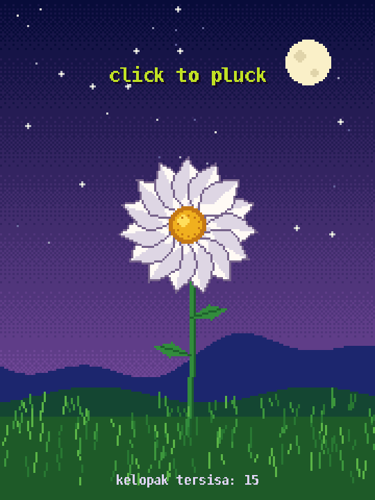
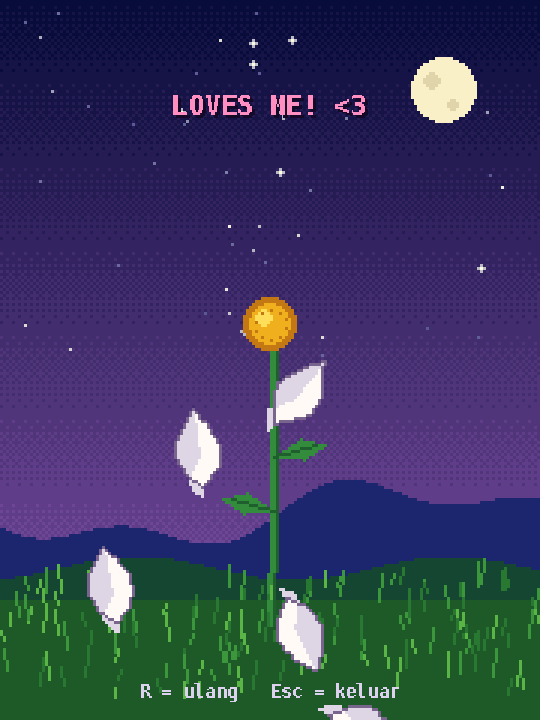

# Loves me, loves me not

Game pixel art kecil yang dibuat dengan Python dan pygame. Cabut kelopak bunga satu per satu sambil bergantian "loves me" dan "loves me not". Kelopak terakhir yang menentukan hasilnya.



## Fitur

- Grafis pixel art 180×240 yang diperbesar tajam (pixel-perfect) sesuai ukuran jendela
- Langit malam dengan gradasi dither, bintang berkelip, bulan, bukit, dan rumput yang bergoyang
- Kelopak yang dicabut jatuh berputar dengan gravitasi dan hambatan udara
- Jumlah kelopak diacak tiap putaran (9–15), jadi hasil akhirnya juga acak

## Cara menjalankan

```bash
pip install -r requirements.txt
python loves_me_not.py
```

## Kontrol

| Tombol | Fungsi |
| --- | --- |
| Klik kiri / Spasi | Cabut satu kelopak |
| R | Ulang dengan bunga baru |
| Esc | Keluar |

## Tampilan

| Awal | Akhir |
| --- | --- |
|  |  |

Video lengkap: [demo/demo.mp4](demo/demo.mp4)

---

Dibuat oleh Ahmad Umraithi
